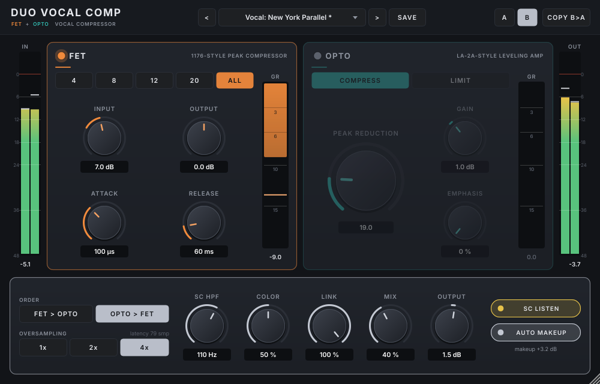
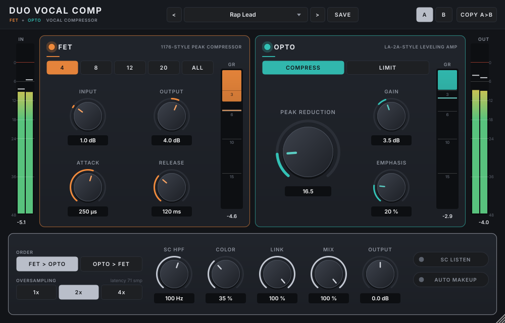

# Duo Vocal Comp

> **Duo Vocal Comp continues as [Axell Duo Compressor](https://github.com/zmardanian/axell-duo-compressor).**
> Version 2 adds a clean detector mode, a true-peak limiter, Mid/Side, an external side-chain with its own EQ,
> threshold / knee / range / hold controls and a measured LA-2A model. It replaces this plugin in your DAW and
> opens Duo Vocal Comp 1.x projects with the same settings and the same sound. This repository stays available
> for the 1.0.0 release.

A two-stage vocal compressor VST3 for Linux: a **FET (1176-style)** peak compressor and an
**opto (LA-2A-style)** leveler in one plugin. It was built for rap and boom bap vocals, and works
on any voice, bus or master that needs fast peak control plus slow, musical leveling.


## Features

- **FET stage (1176-style):** fixed threshold, the INPUT knob drives into it. Attack 20–800 µs,
  release 50–1100 ms with program-dependent slowdown, ratios 4 / 8 / 12 / 20 and "All buttons".
- **Opto stage (LA-2A-style):** ~10 ms attack and a two-stage program-dependent release (fast first
  half, then a 0.5–5 s tail that slows down after long, hard compression). Compress and Limit modes,
  plus HF emphasis so it reacts more to sibilance.
- **Stage order swap:** FET > Opto (the classic chain) or Opto > FET.
- **Sidechain HPF** (20–300 Hz) that keeps plosives, 808 bleed and mic bumps from pumping either
  detector, with **SC Listen** so you can hear what the detectors hear.
- **Color:** analog-style harmonics (FET 2nd + 3rd harmonic grit that grows with compression, opto
  2nd harmonic).
- **Parallel Mix**, **stereo Link** (0–100 %), **Auto Makeup** and a final **Output** gain.
- **Oversampling** 1x / 2x (default) / 4x. Latency is always reported to the host, so plugin delay
  compensation lines up.
- **Metering:** input and output peak meters plus per-stage gain-reduction meters with peak hold.
- **Presets:** 22 level-matched factory presets, your own presets, and A/B compare with copy.
- Resizable GUI (100–200 %), sharp on HiDPI. Every control has a tooltip, double-click resets a
  knob, and Ctrl/Shift + drag gives fine adjustment.

| | |
|---|---|
|  |  |

## Controls

| Section | Control | Range | What it does |
|---|---|---|---|
| FET | On | on / off | Click-free bypass of the FET stage |
| FET | Ratio | 4:1, 8:1, 12:1, 20:1, All | How hard peaks are clamped |
| FET | Input | −12 … +30 dB | Drives the signal into the fixed threshold (more input = more compression) |
| FET | Output | −24 … +24 dB | Makeup gain after the FET |
| FET | Attack | 20 … 800 µs | How fast the FET grabs a peak |
| FET | Release | 50 … 1100 ms | How fast it lets go |
| Opto | On | on / off | Click-free bypass of the opto stage |
| Opto | Mode | Compress / Limit | ~3:1 soft leveling, or ~10:1 tighter hold |
| Opto | Peak Reduction | 0 … 100 | Amount of leveling |
| Opto | Gain | −12 … +24 dB | Makeup gain after the opto |
| Opto | Emphasis | 0 … 100 % | Makes the opto react more to bright, harsh sounds |
| Global | Order | FET > Opto / Opto > FET | Stage order |
| Global | Oversampling | 1x / 2x / 4x | 2x is the default; 4x for mixing and mastering |
| Global | SC HPF | 20 … 300 Hz | High-pass filter on both detectors |
| Global | Color | 0 … 100 % | Analog-style harmonics |
| Global | Link | 0 … 100 % | Stereo link of the detectors |
| Global | Mix | 0 … 100 % | Dry/wet blend (parallel compression) |
| Global | Output | −24 … +24 dB | Final output level |
| Global | SC Listen | on / off | Solo the detector signal (after SC HPF and Emphasis) |
| Global | Auto Makeup | on / off | Slowly adds back the average gain reduction |

The header holds the preset menu (with previous/next), **Save**, and **A / B / Copy**.

## Factory presets

**Vocal:** Rap Lead · Boom Bap Double · Aggressive Parallel (All) · Gentle Leveling · Spoken Word ·
Vocal: Classic Serial (FET > Opto) · Vocal: Opto First, FET Catch · Vocal: New York Parallel ·
Vocal: Upfront Hip-Hop · Vocal: Ad-libs & Hype · Vocal: Sibilance-Aware Leveling ·
Vocal: Transparent Peak Control · Vocal: Sung Hook · Vocal: Lo-fi Grit (All) · Vocal: Broadcast Voice

**Mix / master:** Mix Bus: Glue · Mix Bus: Punch · Master: Transparent Leveling · Master: Peak Catch ·
Master: Parallel Density · Drum Bus: Boom Bap Smash

**Utility:** Init

User presets are saved to `~/.local/share/DuoVocalComp/Presets`.

**Starting point for a rap lead:** FET Input +6 to +10 dB, 4:1, attack ~200 µs, release ~150 ms
(3–6 dB of gain reduction on peaks), then opto Peak Reduction 25–40 in Compress mode (2–5 dB of slow
leveling). Match levels with the Output / Gain knobs.

## Requirements

- x86_64 Linux with glibc 2.39 or newer (for example Bazzite, Fedora 40+, Ubuntu 24.04+)
- Any VST3 host. Tested in REAPER.
- The system libraries `libfreetype` and `libfontconfig` (present on every desktop distribution)

## Install

1. Download `DuoVocalComp-1.0.0-linux-x86_64.tar.gz` from the
   [latest release](https://github.com/zmardanian/duo-vocal-comp/releases/latest).
2. Extract it and run the installer:

   ```bash
   tar xzf DuoVocalComp-1.0.0-linux-x86_64.tar.gz
   cd DuoVocalComp-1.0.0-linux-x86_64
   ./install.sh
   ```

3. Restart your DAW (REAPER scans new plugins at startup), then search for "Duo" in the FX browser.

`install.sh` copies the plugin to `~/.vst3`. It only ever replaces an older copy of Duo Vocal Comp,
and it checks that every system library the plugin needs is present.

To check the download (optional), run this in the folder with both files:

```bash
sha256sum -c SHA256SUMS.txt
```

### Manual install

Copy the bundle into your user VST3 folder:

```bash
mkdir -p ~/.vst3 && cp -r "Duo Vocal Comp.vst3" ~/.vst3/
```

If your DAW does not find it, add `~/.vst3` to its VST3 search path. In REAPER that is
*Options → Preferences → Plug-ins → VST*; on Fedora atomic distributions such as Bazzite use
the full path `/var/home/<your-user>/.vst3`, then click *Re-scan*.

### Uninstall

Run `./uninstall.sh` from the extracted release folder, or:

```bash
rm -rf ~/.vst3/"Duo Vocal Comp.vst3"
```

Your own presets stay in `~/.local/share/DuoVocalComp/Presets`; delete that folder if you want
them gone too.

## Build from source

See [docs/DEVELOPMENT.md](docs/DEVELOPMENT.md). In short: CMake ≥ 3.22, a C++17 compiler and the
usual JUCE Linux dependencies. JUCE 8.0.15 is fetched automatically.

## Quality

The DSP is covered by an automated measurement suite (static curves, FET attack/release, opto
release shape, THD, aliasing, null/latency, silence and denormals, block-size invariance, stereo
identity, CPU), run at 44.1–192 kHz, mono and stereo, block sizes 1 to 4096. A second, plugin-level
suite covers parameters, saved state, latency reporting, presets and A/B. The full results are in
[tests/report.md](tests/report.md), the targets in
[docs/ENGINEERING_SPEC.md](docs/ENGINEERING_SPEC.md), and the design decisions in
[docs/DECISIONS.md](docs/DECISIONS.md). The plugin passes [pluginval](https://github.com/Tracktion/pluginval)
at strictness level 10. One stereo instance at 48 kHz / 128 samples / 2x oversampling uses about
1.7 % of one CPU core (tested on an 8-core Zen 3 laptop).

## Licence

Duo Vocal Comp is free software, licensed under the
[GNU Affero General Public License v3](LICENSE) because it is built with the
[JUCE](https://juce.com) framework under JUCE's AGPLv3 option. Third-party components and their
licences (JUCE, the Steinberg VST3 SDK under MIT, the Inter typeface under SIL OFL 1.1, and others)
are listed in [THIRD_PARTY_NOTICES.md](THIRD_PARTY_NOTICES.md).

"1176" and "LA-2A" are used only to describe the style of compression; this project is not
affiliated with or endorsed by their trademark holders. VST is a registered trademark of
Steinberg Media Technologies GmbH.
